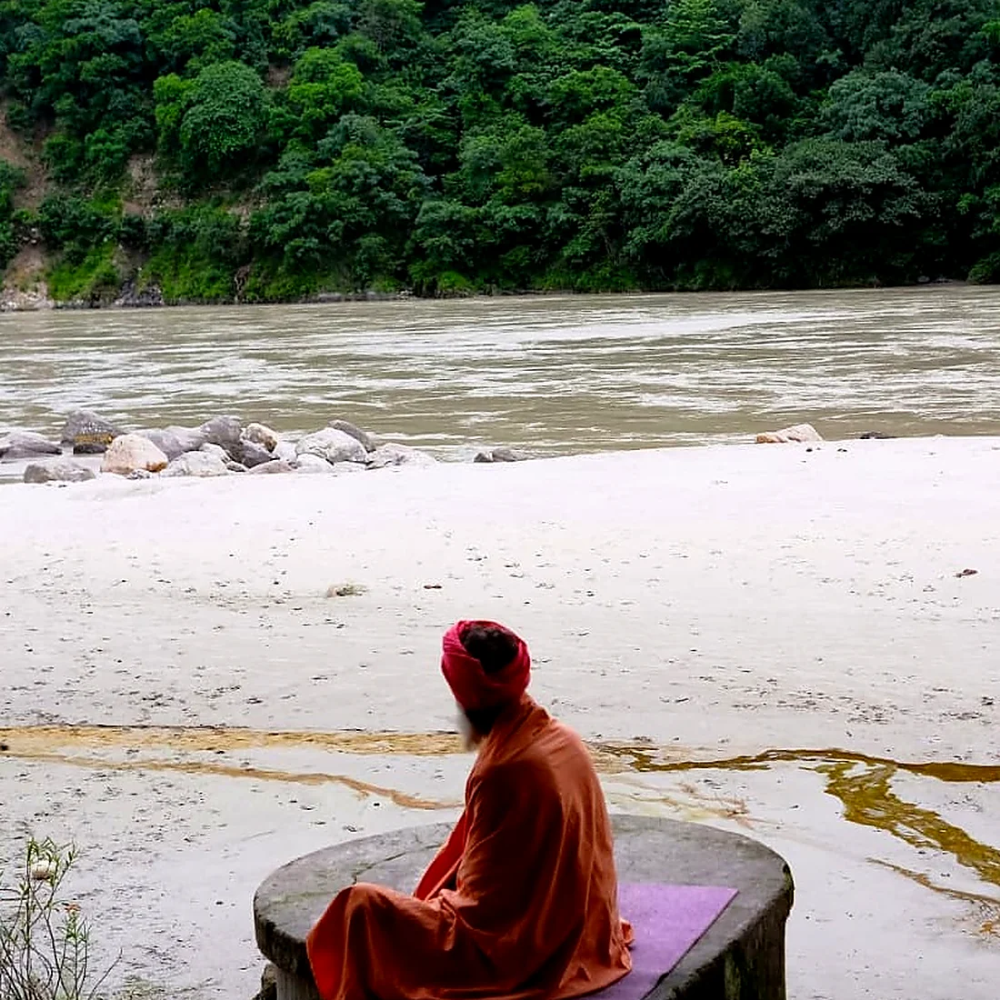

Most of what I have written about the Shiva Svarodaya has been about where it fails. The verse that predicts which nostril will be open from the lunar day is the rule the whole system rests on, and it is the one the evidence contradicts.

So I had been reading the text as a forecaster and grading it as a forecaster. That was an incomplete reading. The text does not only claim you can tell which nostril is flowing. It claims you can change it, deliberately, and that changing it is the point of knowing.

That is a different kind of claim, and a better one. A forecast can be right by luck. An intervention either moves the thing or it does not. So I went looking for whether this one does.

<figure style="margin:32px 0">

<figcaption style="font-size:13px;color:#5E6F68;margin-top:10px;text-align:center">On the bank above Rishikesh.</figcaption>
</figure>

## The instruction nobody quotes

The famous verses of this text are the ones about what the breath means. The operational verses are duller and more useful.

  
शशाङ्कं वारयेद्रात्रौ दिवा वारयेद्भास्करम्। इत्यभ्यासरतो नित्यं स योगी नात्र संशयः॥६६॥ सूर्येण बध्यते सूर्यश्चन्द्रश्चन्द्रेण बध्यते। यो जानाति क्रियामेतां त्रैलोक्यं वशगं क्षणात्॥६७॥

  
śaśāṅkaṃ vārayed rātrau divā vārayed bhāskaram | ity abhyāsarato nityaṃ sa yogī nātra saṃśayaḥ ||66|| sūryeṇa badhyate sūryaś candraś candreṇa badhyate | yo jānāti kriyām etāṃ trailokyaṃ vaśagaṃ kṣaṇāt ||67||

  
One should check the left channel at night and the right by day. Whoever is constantly devoted to this practice is a <em>yogī</em>, without question. Sun is bound by sun and moon by moon; whoever knows this operation gains mastery in an instant. — Verses 66–67

The verb is *vārayet* — to check, to hold back, to turn away. It is an instruction to act on the breath, not to watch it. And verse 101 is blunter still: *kāryaṃ nāḍīpracālanam*, the channel should be set flowing to suit the action.

Set flowing. The text treats which nostril is open as a dial you are expected to turn.

Four methods come down through the tradition for turning it: lie on the opposite side; apply sustained pressure into the armpit or against the side of the chest; breathe forcibly through one nostril; exert yourself physically. The second of these is why the *yogadaṇḍa* exists — the T-shaped crutch-staff you see in old images, wedged under the arm. It is usually explained as a prop for long sitting. The *Svarodaya* tradition treats it as an instrument.

Four methods, four claims. They do not hold up equally.

## Lying on your side is the one that works

Here is the finding, and it surprises people: lying on one side opens the *other* nostril. The side you are resting on congests. The side in the air clears.

Kahana-Zweig and colleagues give the cleanest evidence. In *PLoS ONE* in 2016 they fitted 33 healthy adults with a dual-nostril airflow logger and recorded them for a full 24 hours — the largest continuous dataset on the nasal cycle I know of. Posture tracked dominance, and it tracked it contralaterally. Mean laterality was 0.21 while lying on the left and −0.29 while lying on the right, a difference significant at p < 0.002.

The older rhinometry work points the same way. Roithmann and colleagues, writing in the *Brazilian Journal of Otorhinolaryngology*, summarise the side-lying studies that preceded theirs. Fouke and Jackson put eight people on their right side for fifteen minutes: the lower nasal cavity's volume fell from about 29.3 to 19.5 cm³ while the upper cavity's rose from about 20.9 to 25.5 cm³. Cole and Haight had reported the same direction in 1984 — patency down on the side turned down, up on the other, with total resistance barely changed in healthy people.

<figure style="margin:28px 0">
<svg viewBox="0 0 540 272" style="width:100%;height:auto;display:block" font-family="system-ui, sans-serif" aria-label="Chart of nasal cavity volume in eight people lying on one side for fifteen minutes, from Fouke and Jackson as summarised by Roithmann and colleagues. The down-side cavity, the one resting against the bed, fell from 29.3 to 19.5 cubic centimetres. The up-side cavity rose from 20.9 to 25.5 cubic centimetres. The side you lie on closes and the side in the air opens.">
  <text x="14" y="18" font-size="12.5" font-weight="600" fill="#5E6F68">NASAL CAVITY VOLUME AFTER 15 MINUTES ON ONE SIDE</text>

  <text x="14" y="48" font-size="13" fill="#17231F">Down-side cavity — before</text>
  <rect x="14" y="56" width="430" height="22" rx="5" fill="#17231F" fill-opacity=".14"/>
  <text x="452" y="72" font-size="13" font-weight="600" fill="#17231F">29.3 cm³</text>

  <text x="14" y="100" font-size="13" fill="#17231F">Down-side cavity — after</text>
  <rect x="14" y="108" width="286" height="22" rx="5" fill="#E4744F"/>
  <text x="308" y="124" font-size="13" font-weight="600" fill="#17231F">19.5 cm³</text>

  <line x1="14" y1="146" x2="526" y2="146" stroke="#17231F" stroke-opacity=".15" stroke-width="1"/>

  <text x="14" y="172" font-size="13" fill="#17231F">Up-side cavity — before</text>
  <rect x="14" y="180" width="306" height="22" rx="5" fill="#17231F" fill-opacity=".14"/>
  <text x="328" y="196" font-size="13" font-weight="600" fill="#17231F">20.9 cm³</text>

  <text x="14" y="224" font-size="13" fill="#17231F">Up-side cavity — after</text>
  <rect x="14" y="232" width="374" height="22" rx="5" fill="#7FA88C"/>
  <text x="396" y="248" font-size="13" font-weight="600" fill="#17231F">25.5 cm³</text>
</svg>
<figcaption style="font-size:13px;color:#5E6F68;margin-top:10px">Fouke and Jackson, eight subjects, as summarised by Roithmann and colleagues. The side you rest on closes; the side in the air opens.</figcaption>
</figure>

Now the honest part. Eight people. Fourteen in O'Flynn's study, which did not fit the pattern at all — his changes were larger on the side that started out open, and did not reach significance. Thirty-three in the biggest one. These are small studies, and the direction is consistent across them rather than the size of the effect.

But the direction is what the instruction needs. If you want the left nostril open, lie on your right side and wait. In the studies that tested it, the wait was five to fifteen minutes.

## The crutch under the arm

Pressure in the armpit works the same way, and this is the method yoga books state most confidently and the literature documents least.

Eccles reported in *Rhinology* in 1986 that applying pressure to the axilla of a supine subject produced reciprocal changes in the two nasal passages — resistance up on the pressed side, down on the other — and attributed it to a reflex change in sympathetic tone. The dedicated study is Haight and Cole's *Unilateral Nasal Resistance and Asymmetrical Body Pressure*, published the same year, which is where the effect is worked out properly.

That is the whole public evidence base as far as I can find it: two papers, 1986, overlapping authors. The effect is real and the mechanism is sensible — pressure receptors in the chest wall modulating sympathetic outflow to the nasal vessels on that side. But it rests on less than the side-lying result does, and it is stated in yoga teaching with far more confidence than the side-lying result, which is the wrong way round.

I should say that this closes something on my own list. When I built the swar yoga tool I graded the armpit method on the commentary alone, because I had not found a study. These two are the study. They are thinner than I would like, and I am recording them as what the claim actually rests on.

## Exertion opens both sides, and not for long

The fourth method is the easiest to test and the least useful.

Fonseca and colleagues, in the *Brazilian Journal of Otorhinolaryngology* in 2006, measured nasal volume in 19 healthy young adults by acoustic rhinometry: at rest, immediately after five minutes of cycling at half their maximum power, and at 10 and 20 minutes afterwards. Total nasal volume rose by a mean of 33.3% (± 17.0), p < 0.001.

A third more airway, from five minutes on a bicycle. That is a large effect and it is not in doubt.

It is also the wrong tool for this job, for two reasons. It opens both sides — generalised sympathetic activation does not pick a nostril — so it cannot produce the asymmetry the text is asking for. And it does not last. By twenty minutes the volume was back to where it started: 12.4 cm³ against 12.1 cm³ at rest.

So exercise unblocks your nose. It does not steer it.

## The method I could not find a study for

Verse 67 is the most specific of the four and the one I most wanted to check. *Sun is bound by sun, moon by moon.* Like acts on like. The reading that makes sense of it is that you reverse a dominant side by breathing hard through the side that is already open, until the system flips, rather than by trying to force the blocked side.

That is a sharp, testable, slightly counter-intuitive prediction, and I cannot find anyone who has tested it.

There is a literature on forced unilateral nostril breathing, going back to Shannahoff-Khalsa's work in the late 1980s and continuing into recent EEG studies. But it asks a different question. It asks what breathing through one nostril does to you — to heart rate, to cognitive performance, to hemispheric measures. I could find nothing asking whether forced breathing through the open nostril reverses the dominance itself.

So the status of verse 67 is not "weak". It is untested. I would rather say that plainly than grade it on nothing.

<figure style="margin:28px 0">
<svg viewBox="0 0 540 328" style="width:100%;height:auto;display:block" font-family="system-ui, sans-serif" aria-label="A comparison of four traditional methods for changing which nostril is open. Lying on the opposite side switches sides and has the strongest evidence, from studies of 8 to 33 people. Pressure in the armpit, the yogadanda, switches sides and rests on two papers from 1986 with overlapping authors. Physical exertion opens both sides rather than choosing one, shown in nineteen people, and fades within twenty minutes. Forced breathing through the already-open nostril, verse 67, has no study testing it that I could find.">
  <text x="14" y="18" font-size="12.5" font-weight="600" fill="#5E6F68">FOUR METHODS, GRADED</text>

  <text x="14" y="50" font-size="13.5" font-weight="600" fill="#17231F">Lie on the opposite side</text>
  <text x="14" y="68" font-size="12" fill="#5E6F68">Switches sides. 8–33 people, consistent direction.</text>
  <rect x="14" y="78" width="512" height="9" rx="4.5" fill="#17231F" fill-opacity=".07"/>
  <rect x="14" y="78" width="410" height="9" rx="4.5" fill="#2E7FA8"/>

  <text x="14" y="120" font-size="13.5" font-weight="600" fill="#17231F">Pressure in the armpit (the yogadaṇḍa)</text>
  <text x="14" y="138" font-size="12" fill="#5E6F68">Switches sides. Two papers, 1986, overlapping authors.</text>
  <rect x="14" y="148" width="512" height="9" rx="4.5" fill="#17231F" fill-opacity=".07"/>
  <rect x="14" y="148" width="236" height="9" rx="4.5" fill="#C6A15B"/>

  <text x="14" y="190" font-size="13.5" font-weight="600" fill="#17231F">Physical exertion</text>
  <text x="14" y="208" font-size="12" fill="#5E6F68">Opens both sides. +33% volume in 19 people, gone by 20 min.</text>
  <rect x="14" y="218" width="318" height="9" rx="4.5" fill="#E4744F"/>
  <text x="344" y="227" font-size="11.5" fill="#5E6F68">— real, but picks no side</text>

  <text x="14" y="260" font-size="13.5" font-weight="600" fill="#17231F">Force the breath through the open side (v67)</text>
  <text x="14" y="278" font-size="12" fill="#5E6F68">The text's own method. No study I could find tests it.</text>
  <rect x="14" y="288" width="512" height="9" rx="4.5" fill="#17231F" fill-opacity=".07"/>
  <text x="14" y="316" font-size="12" fill="#5E6F68">Bar length is my reading of how much each claim rests on, not an effect size.</text>
</svg>
<figcaption style="font-size:13px;color:#5E6F68;margin-top:10px">The strength of the evidence runs almost exactly opposite to the confidence with which each method is taught.</figcaption>
</figure>

## The objection, which is the interesting part

Here is where it turns on itself.

If posture moves nasal dominance this reliably, how much of the famous rhythm is a rhythm at all? Haight and Cole asked exactly that, in *The Laryngoscope* in 1989, under the title *Is the nasal cycle an artifact? The role of asymmetrical postures*. If every hour you spend leaning on one elbow is an hour in which the nostril is being set from outside, then some of what has been recorded as an endogenous two-hour clock is a record of how people happened to be sitting.

The Kahana-Zweig data speak to this a little. They found no change in laterality amplitude immediately before versus after a change of position, which argues against the cycle being a simple artefact of moving about. But that analysis was aimed at a narrower worry — whether the measuring cannula was being squashed in recumbency — and it does not settle the broader question.

And note what this does to the two halves of the text. The better the steering works, the worse the forecasting looks. A nostril that can be flipped by lying down for ten minutes is not a nostril that was ever going to keep to a lunar timetable. The *Svarodaya*'s most defensible mechanism quietly undermines its most famous claim.

I find that more interesting than either half on its own.

## The one instruction that lands

One more verse, because it is the best practical line in the book and it works for a reason the book could not have known.

  
भुक्तमार्गेण मन्दाग्नौ स्त्रीणां वश्यादिकर्मणि। शयनं सूर्यवाहेन कर्तव्यं सर्वदा बुधैः॥१२२॥

  
bhuktamārgeṇa mandāgnau strīṇāṃ vaśyādikarmaṇi | śayanaṃ sūryavāhena kartavyaṃ sarvadā budhaiḥ ||122||

  
When digestion is sluggish after eating, the wise should always lie down with the right channel flowing. — Verse 122

Work the mechanics. To lie down with the right nostril flowing, you must lie on your *left* side, because the down-side congests. The instruction "sleep with the sun channel flowing" is, operationally, the instruction "sleep on your left side after a heavy meal."

Which is the standard positional advice for reflux. Khoury and colleagues monitored oesophageal pH in patients with reflux disease during spontaneous sleep and published it in *The American Journal of Gastroenterology* in 1999: the right lateral position was associated with more nighttime acid exposure than the left. In the left lateral position the junction between oesophagus and stomach sits above the pool of gastric contents; on the right it sits below it. Ten patients, so not a large study, but the direction has held up and positional advice is routine in reflux management now.

The text gets the right answer about post-meal discomfort through a theory about solar and lunar channels that has nothing to do with the mechanism. That happens more often than you would expect with this material, and it is worth being clear about what it does and does not license. It makes verse 122 a good instruction. It does not make the theory behind it true.

## What I take from this

I have spent a lot of time grading this text as an oracle and finding it wanting. Read as an engineering manual, it does considerably better.

The claim that you can set which nostril is flowing is correct. The method it recommends most — change your posture — is the one with the best support, and the tradition found it with no instruments and no account of why it works. The crutch under the arm is probably real and thinly documented. The exertion method works and does the wrong thing. Its own signature trick, sun binding sun, nobody has checked.

What I would actually do with this: if one nostril is blocked and I want the other open, lie down on the blocked side for ten minutes. That is a lever I can pull and watch work, and the watching is the part that matters — it is falsifiable in ten minutes on my own face, which is more than can be said for most of what this text asserts.

I notice I trust the tradition more after writing this, and in a narrower way. Not as a system that knows what the breath means. As a long, patient record of people paying close attention to something real, and finding handles on it.

## Sources

1. Kahana-Zweig R, Geva-Sagiv M, Weissbrod A, Secundo L, Soroker N, Sobel N. Measuring and characterizing the human nasal cycle. *PLoS ONE* (2016), 11(10):e0162918. [doi.org](https://doi.org/10.1371/journal.pone.0162918)
2. Roithmann R, Demeneghi P, Faggiano R, Cury A. Effects of posture change on nasal patency. *Brazilian Journal of Otorhinolaryngology* (2005), 71(4):478–484. Summarises the earlier side-lying studies of Fouke and Jackson (1992), Kase and colleagues (1994) and O'Flynn (1993). [bjorl.org](https://www.bjorl.org//en-effects-posture-change-on-nasal-articulo-S1808869415312039)
3. Cole P, Haight JSJ. Posture and nasal patency (1984). [pubmed.ncbi.nlm.nih.gov](https://pubmed.ncbi.nlm.nih.gov/6703492/)
4. Eccles R. The effects of posture on nasal resistance to airflow. *Rhinology* (1986), 24:75. [rhinologyjournal.com](https://www.rhinologyjournal.com/Rhinology_issues/manuscript_2066.pdf)
5. Haight JSJ, Cole P. *Unilateral Nasal Resistance and Asymmetrical Body Pressure* (1986). [pubmed.ncbi.nlm.nih.gov](https://pubmed.ncbi.nlm.nih.gov/3462397/)
6. Haight JSJ, Cole P. Is the nasal cycle an artifact? The role of asymmetrical postures. *The Laryngoscope* (1989), 99(5). [doi.org](https://doi.org/10.1288/00005537-198905000-00013)
7. Rohrmeier C, Schittek S, Ettl T, Herzog M, Kuehnel TS. The nasal cycle during wakefulness and sleep and its relation to body position. *The Laryngoscope* (2014). [doi.org](https://doi.org/10.1002/lary.24546)
8. Calvo-Henríquez C and colleagues. The recumbent position affects nasal resistance: a systematic review and meta-analysis. *The Laryngoscope* (2021). [doi.org](https://doi.org/10.1002/lary.29509)
9. Fonseca MT, Machado JAvP, Pereira SA, Pinto KM, Voegels RL. Effects of physical exercise in nasal volume. *Brazilian Journal of Otorhinolaryngology* (2006), 72(2):256–260. [bjorl.org](https://www.bjorl.org/en-effects-physical-exercise-in-nasal-articulo-S1808869415300653)
10. Khoury RM, Camacho-Lobato L, Katz PO, Mohiuddin MA, Castell DO. Influence of spontaneous sleep positions on nighttime recumbent reflux in patients with gastroesophageal reflux disease. *The American Journal of Gastroenterology* (1999), 94(8). [doi.org](https://doi.org/10.1111/j.1572-0241.1999.01279.x)
