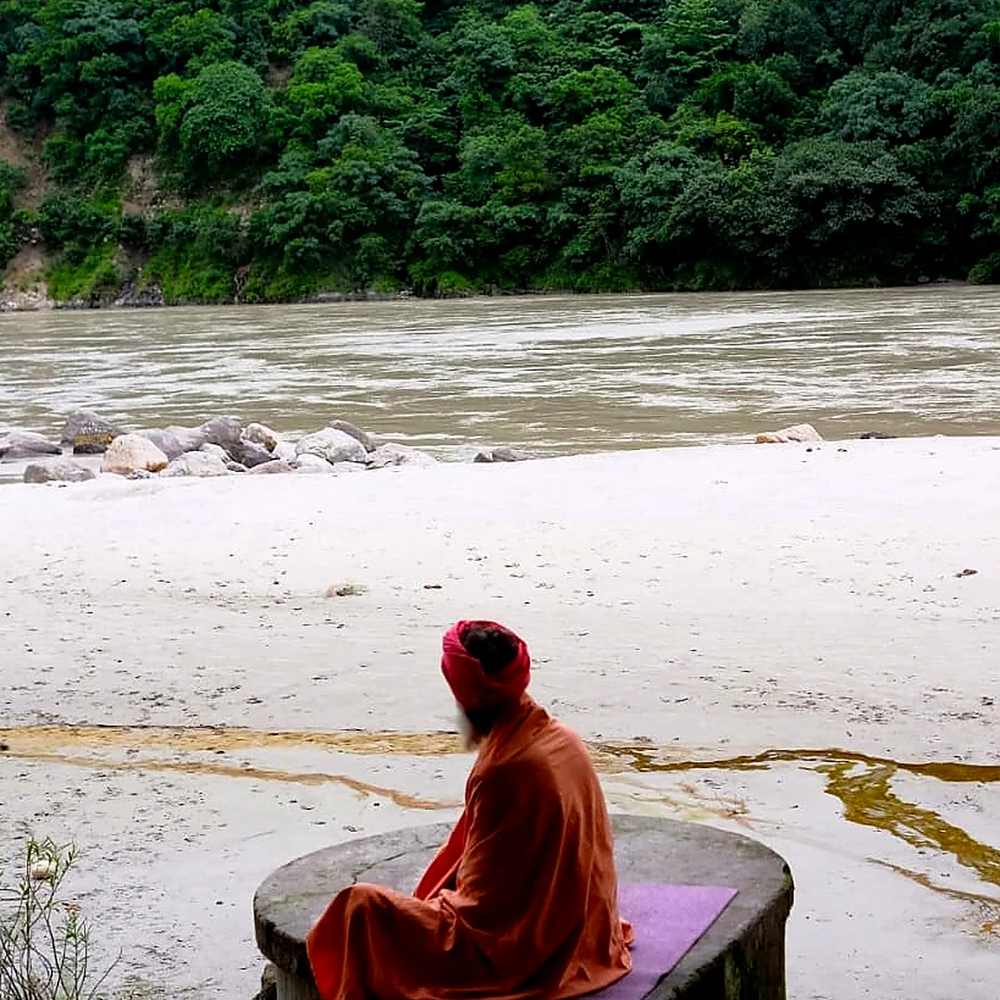

This week I was sent a discussion that had grown up around an anonymous account. Someone's intensive retreat practice had been followed, more than once, by a psychiatric episode — the kind with persecutory beliefs in it, the fear that the person closest to you means you harm.

The account was not the striking part. The replies were. Several people had written some version of the same sentence — *mysticism and madness walk a razor's edge* — and they had written it as reassurance.

I want to be careful about what I am arguing here. I am not arguing that the philosophy is dangerous. I have a long piece on this site about [Abhinavagupta and recognition](/recognition-as-liberation.html), and I think the Trika is the most interesting thing in Indian philosophy. What I want to argue is narrower: that one line of folk wisdom is being asked to do a job it cannot do, and that the research has something better to offer than the razor's edge.

## The claim, stated plainly

The claim is that an experience which looks like a psychiatric episode from the outside may be an awakening from the inside, and that the resemblance between the two is so close that you cannot reliably tell them apart. From which it follows — and this is the part that matters — that you should be slow to call a doctor, because you might be interrupting something.

Set out like that, it has two separate pieces. The first is a claim about resemblance. The second is a claim about what to do. The research is reasonably clear on the first and very clear that it does not license the second.

## What the surveys actually find

Start with how common difficulty is, because the answer is higher than most teaching rooms admit and lower than the internet suggests.

The best population-level figure comes from Goldberg, Lam, Britton and Davidson, published in *Psychotherapy Research* in 2022. They screened 953 people in the United States, found 470 with a lifetime meditation practice, and got 434 of them through a follow-up survey on adverse effects — a response rate of 92.3 per cent, which is unusually good.

<figure style="margin:28px 0">
<svg viewBox="0 0 540 300" style="width:100%;height:auto;display:block" font-family="system-ui, sans-serif" aria-label="Bar chart of meditation-related adverse effects among 434 United States meditators surveyed by Goldberg and colleagues in 2022. Fifty per cent endorsed at least one specific adverse effect. 32.3 per cent endorsed the general adverse effects item. 10.4 per cent reported effects lasting a month or longer. 10.6 per cent reported some functional impairment. 1.2 per cent reported impairment lasting a month or longer.">
  <text x="14" y="18" font-size="12.5" font-weight="600" fill="#5E6F68">MEDITATION-RELATED ADVERSE EFFECTS, 434 US MEDITATORS</text>
  <text x="14" y="36" font-size="11.5" fill="#5E6F68">Goldberg, Lam, Britton &amp; Davidson (2022)</text>

  <text x="14" y="68" font-size="13" fill="#17231F">At least one specific effect</text>
  <rect x="14" y="78" width="250" height="24" rx="5" fill="#2E7FA8" fill-opacity=".30"/>
  <text x="274" y="96" font-size="13" font-weight="600" fill="#17231F">50.0%</text>

  <text x="14" y="128" font-size="13" fill="#17231F">General adverse-effects item</text>
  <rect x="14" y="138" width="162" height="24" rx="5" fill="#2E7FA8" fill-opacity=".45"/>
  <text x="186" y="156" font-size="13" font-weight="600" fill="#17231F">32.3%</text>

  <text x="14" y="188" font-size="13" fill="#17231F">Some functional impairment</text>
  <rect x="14" y="198" width="53" height="24" rx="5" fill="#E4744F" fill-opacity=".8"/>
  <text x="77" y="216" font-size="13" font-weight="600" fill="#17231F">10.6%</text>

  <text x="14" y="248" font-size="13" fill="#17231F">Impairment lasting a month or more</text>
  <rect x="14" y="258" width="6" height="24" rx="2" fill="#E4744F"/>
  <text x="30" y="276" font-size="13" font-weight="600" fill="#17231F">1.2%</text>
</svg>
<figcaption style="font-size:13px;color:#5E6F68;margin-top:10px">Half the sample reported something. One in ten reported it getting in the way of their life. Roughly one in eighty reported that lasting a month or more. Anxiety, traumatic re-experiencing and emotional sensitivity were the commonest effects, and childhood adversity predicted higher risk. People who reported adverse effects were, notably, just as glad to have practised as people who did not.</figcaption>
</figure>

That last detail is the one I keep returning to. The people who had a hard time were not sorry they had meditated. Difficulty and value are not opposites, and a blog that only reported the difficulty would be as dishonest as a retreat brochure that only reported the value.

The systematic review runs in the same direction. Farias, Maraldi, Lucchetti and Wallenkampf pooled 83 studies and 6,464 meditators in *Acta Psychiatrica Scandinavica* in 2020 and arrived at an overall adverse-event prevalence of 8.3 per cent — but with an enormous split by design: 3.7 per cent in experimental studies, 33.2 per cent in observational ones. Heterogeneity was 95 per cent, which is a polite statistical way of saying these studies are not measuring the same thing. Psychotic or delusional symptoms appeared in ten of the 83 studies. The authors are explicit that trials which only monitor passively, or only log serious events, will undercount, and equally explicit that observational data cannot establish cause.

And then there is the qualitative map. Lindahl, Fisher, Cooper, Rosen and Britton interviewed just under a hundred Western Buddhist practitioners and teachers across Theravāda, Zen and Tibetan traditions and published the result in *PLOS ONE* in 2017: a taxonomy of 59 meditation-related experiences across seven domains, including a domain for changes in the sense of self. Their finding was not that these experiences are bad. It was that the same experience was interpreted in wildly different ways, and that distress and impairment ran from transient to severe and enduring. That study went looking for difficulty, so it says nothing about how common any of it is. What it establishes is that the catalogue is real and that interpretation is doing a great deal of the work.

## The psychosis case reports are thinner than the internet implies

If meditation reliably produced psychosis you would expect a substantial case literature. Sharma, Mahapatra and Gupta went looking for it across seven databases and published the result in the *Irish Journal of Psychological Medicine*. They found 19 studies describing 28 cases, aged 18 to 57, evenly split between men and women: fourteen acute psychosis, seven schizophrenia, three mania with psychotic features, one schizoaffective. The practices involved ranged from transcendental meditation through mindfulness and Buddhist-derived methods to Bikram yoga and pranic healing — which is to say, no single technique is implicated.

Fourteen of the 28 had other precipitating factors on board: insomnia, poor food intake, prior mental illness, stress, substance use. Half. Their own conclusion is that a causal link is hard to establish and that better-designed studies are needed.

Twenty-eight published cases across the entire literature, against hundreds of millions of people who meditate, is not an epidemic. It is also not nothing, and it is exactly the shape of evidence you would expect if intensive practice were a trigger in a small number of already-vulnerable people rather than a cause in the general population. I cannot distinguish those two readings with what exists, and neither can anyone else.

## The finding that actually answers the question

Here is the part I did not know before this week, and it is better than the razor's edge.

There is a research literature on people who have persistent psychotic-like experiences — voices, visions, first-rank symptoms — and who have never needed psychiatric care. Not people in remission. People who have these experiences and are fine.

Peters and colleagues studied 259 people for the UNIQUE project and reported it in *World Psychiatry* in 2016: 92 with persistent psychotic experiences and no need for care, 84 with a diagnosed psychotic disorder, and 83 controls. The non-clinical group had hallucinations in every modality, and an *earlier* age of onset than the patients. On the experiences themselves, they were not a milder group.

Where they differed was everywhere else. Little paranoia and little delusional thinking; ideas of reference were the one exception, common in the group but still significantly less frequent than in the patients. Fewer cognitive difficulties, fewer negative symptoms. No drop in psychosocial functioning. Less social adversity. Psychologically they looked like the controls: intact self-esteem, high life satisfaction, no current emotional problems. Childhood trauma was present in both the clinical and non-clinical groups, so that was not the divider either.

Heriot-Maitland, Knight and Peters had reached a compatible conclusion by a different route in the *British Journal of Clinical Psychology* in 2012. They interviewed twelve people who had had out-of-the-ordinary experiences in the previous five years, half of whom had ended up involved with mental-health services and half of whom had not, and analysed the interviews phenomenologically. The triggers were similar. The experiences themselves were similar. What differed was the interpersonal and personal context — and the theme they singled out as decisive was **validation**: whether there was anybody around who could help the person place what had happened to them.

<figure style="margin:28px 0">
<svg viewBox="0 0 540 332" style="width:100%;height:auto;display:block" font-family="system-ui, sans-serif" aria-label="A comparison of what is similar and what differs between people with psychotic-like experiences who need psychiatric care and people who do not. Similar: the triggers, the sensory content of the experience, the age of onset, and a history of childhood trauma. Different: the level of distress, the degree of paranoia and persecutory belief, everyday functioning, social adversity, and whether anyone was available to validate and help place the experience. The conclusion is that the experience itself does not predict the outcome.">
  <text x="14" y="18" font-size="12.5" font-weight="600" fill="#5E6F68">WHAT DOES NOT TELL THE TWO GROUPS APART</text>
  <rect x="14" y="30" width="512" height="112" rx="8" fill="#17231F" fill-opacity=".06"/>
  <text x="30" y="54" font-size="13" fill="#17231F">The trigger</text>
  <text x="30" y="76" font-size="13" fill="#17231F">What the experience contained — voices, visions, dissolution</text>
  <text x="30" y="98" font-size="13" fill="#17231F">Age at which it started <tspan fill="#5E6F68">(earlier in the non-clinical group)</tspan></text>
  <text x="30" y="120" font-size="13" fill="#17231F">A history of childhood trauma <tspan fill="#5E6F68">(present in both)</tspan></text>

  <text x="14" y="176" font-size="12.5" font-weight="600" fill="#2E7FA8">WHAT DOES</text>
  <rect x="14" y="188" width="512" height="112" rx="8" fill="#2E7FA8" fill-opacity=".14"/>
  <text x="30" y="212" font-size="13" fill="#17231F">Distress, and how much control the person has over it</text>
  <text x="30" y="234" font-size="13" fill="#17231F">Paranoia and persecutory belief about other people</text>
  <text x="30" y="256" font-size="13" fill="#17231F">Whether ordinary functioning holds — work, food, sleep, relationships</text>
  <text x="30" y="278" font-size="13" fill="#17231F">Whether anyone is there to help place it</text>

  <text x="14" y="324" font-size="12.5" fill="#5E6F68">Peters et al. (2016), n = 259; Heriot-Maitland et al. (2012), n = 12.</text>
</svg>
<figcaption style="font-size:13px;color:#5E6F68;margin-top:10px">Two studies, very different in size and method, converging on the same answer. The content of the experience is a poor discriminator. Distress, control, functioning and context are good ones. This is the reason the razor's-edge line feels true and is still useless: it is true about the content, which is the one thing that does not decide the outcome.</figcaption>
</figure>

I find this genuinely clarifying. The razor's-edge intuition is not wrong about the resemblance. It is wrong about which part of the situation you are supposed to be reading. If you stare at the content of the experience — the dissolution, the light, the sense that the universe is addressing you — you will never settle the question, because the content does not settle it even for researchers with structured interviews. If you look instead at distress, control, functioning and context, you get an answer, and it is an answer you can act on.

Note what this does *not* say. It does not say the non-clinical group were having awakenings. It does not grade anybody's attainment. It says only that whether an unusual experience becomes a clinical problem is decided mostly outside the experience.

<figure style="margin:32px 0">

<figcaption style="font-size:13px;color:#5E6F68;margin-top:10px;text-align:center">Above Rishikesh. The traditions that sent people to sit alone like this also built the thing the research keeps pointing at — a teacher, a lineage, a community who had seen it before and could tell you what you were looking at. The sitting travels well. That part often does not.</figcaption>
</figure>

## The tradition is on the same side of this

The thing that surprised me, rereading the Trika material with this question in mind, is how little support the razor's-edge position finds there.

*Pratyabhijñā* means recognition. The whole architecture of the school rests on liberation being the recognition of something that was never actually lost — not the acquisition of a new state, and emphatically not the accumulation of unusual experiences. Nothing in that framework licenses reading a vision, a dissolution or a conviction of cosmic significance as evidence of attainment. Those are contents. Recognition is not a content.

The tradition's ideal is *jīvanmukti*, liberation while living and embodied, and non-dual Śaivism is unusual among Indian systems in affirming the world rather than seeing through it — manifestation is Śiva's self-display, not a screen in front of him. That is a philosophy in which continuing to work, eat, sleep and love people is not a compromise with realisation. It is closer to the evidence for it.

So the question "if your understanding of Śiva makes you unable to live among Śiva's manifestation, what exactly have you recognised?" is not a modern debunking imported from psychiatry. It is the tradition's own logic, and I think it is a fair reading of where the Pratyabhijñā school stands.

I will not put that argument in anyone's mouth. Abhinavagupta and Swami Lakshmanjoo both wrote and taught at length and are not here to be quoted on a case they never saw.

## "More practice, more realisation" is not a measured claim

The other sentence in that thread worth pulling out is the assumption that ten hours of sitting a day must beat two.

There is no instrument for realisation, so nobody has ever run the dose-response study that would settle this. What *has* been measured points the other way on the only axis we can measure: intensity and retreat conditions are where the difficult experiences cluster. Farias and colleagues note that their observational samples were heavily weighted towards retreat attendees, which is part of why the observational rate was 33 per cent against 3.7 per cent in trials. Lindahl's practitioners frequently located the onset of their difficulties on intensive retreat.

That is a confound as much as a finding — the people who go on long retreats are a selected group. But it is the only dose signal in the literature, and it does not say more is better.

## Where meditation is a treatment, not a risk

It would be a cheap article that stopped there, because the opposite finding also exists.

Cramer and colleagues pooled eight randomised trials with 434 patients in *Global Advances in Health and Medicine* in 2016 and found moderate evidence that mindfulness- and acceptance-based interventions improve total and positive symptoms in psychosis in the short term, and total symptoms in the long term, with no effect on negative symptoms. Six of the eight trials were at low risk of bias.

These are adapted interventions: short sessions, present-moment anchoring, clinical supervision, usually alongside treatment as usual. They are not ten-day silent retreats. The useful conclusion is not "meditation is good for psychosis" or "meditation causes psychosis" but something duller and more accurate — the dose, the format and the supervision are doing most of the work, and the word "meditation" is covering practices that have very little in common.

## What I would actually look at

Not a diagnostic instrument, and not a substitute for one. These are the things the studies above keep finding on the discriminating side of the line.

**Distress and control.** Is the experience distressing, and can the person step out of it, set it down, come back to the room? Chosen states that can be left are in a different category from states that arrive and will not stop.

**Beliefs about other people's intentions.** This is the one I would weight most heavily, and it is the one in the account I was sent. The conviction that someone close to you is poisoning you, experimenting on you, or means you harm is not a form of non-dual insight. It is a persecutory belief, it is frightening to live inside, and it is treatable.

**Function.** Sleep, food, work, the ability to look after yourself and the people who depend on you. Non-dual philosophy has no stake in the loss of any of these.

**Trajectory.** A difficult passage that is resolving is different from one that is deepening over weeks.

**Context.** Is there someone who can help place this — a teacher who has seen it before, a clinician, a person who will say plainly what they are seeing? On the 2012 evidence that is the variable most worth changing, and it is the one most often missing when somebody comes home from a retreat.

And the thing that should not be on the list: how extraordinary the experience was. That is the content, and the content is the part that does not predict.

## The close

The sentence I would take out of circulation is not "mysticism and madness walk a razor's edge". It is the thing people mean when they say it, which is *wait and see*.

A teacher is not a psychiatrist and a psychiatrist is not a teacher, and the useful observation is that they are not competing for the same job. Getting assessed does not cancel anything. If what is happening is a difficult passage in a practice, an assessment will cost someone an afternoon. If it is an episode of psychosis, delay is the one variable with good evidence behind it, and it runs the wrong way.

DSM-IV, for what it is worth, has had a category for this since 1994 — V62.89, Religious or Spiritual Problem. Lukoff, Lu and Turner put the proposal to the task force at the end of 1991 and published the case for it in 1992, precisely so that clinicians would stop filing spiritual crises as pathology by default; it was accepted in 1993. The frame exists. It was built by psychiatrists. It is a better frame than the razor's edge because it lets both things be true at once: that something real is happening, and that it may still need help.

If you are reading this because it describes someone you know — or you — this is worth talking to a doctor about, and intensive practice is worth pausing while you do. That is not a verdict on the experience. It is just the order to do things in.

## Sources

1. Goldberg SB, Lam SU, Britton WB, Davidson RJ. Prevalence of meditation-related adverse effects in a population-based sample in the United States. *Psychotherapy Research* (2022), 32(3):291–305. [doi.org](https://doi.org/10.1080/10503307.2021.1933646)
2. Farias M, Maraldi E, Lucchetti G, Wallenkampf K. Adverse events in meditation practices and meditation-based therapies: a systematic review. *Acta Psychiatrica Scandinavica* (2020), 142(5):374–393. [doi.org](https://doi.org/10.1111/acps.13225)
3. Lindahl JR, Fisher NE, Cooper DJ, Rosen RK, Britton WB. The varieties of contemplative experience: a mixed-methods study of meditation-related challenges in Western Buddhists. *PLOS ONE* (2017), 12(5):e0176239. [doi.org](https://doi.org/10.1371/journal.pone.0176239)
4. Sharma P, Mahapatra A, Gupta R. Meditation-induced psychosis: a narrative review and individual patient data analysis. *Irish Journal of Psychological Medicine* (2022), 39(4):391–397. [doi.org](https://doi.org/10.1017/ipm.2019.47)
5. Peters E, Ward T, Jackson M, Morgan C, Charalambides M, McGuire P, Woodruff P, Jacobsen P, Chadwick P, Garety P. Clinical, socio-demographic and psychological characteristics in individuals with persistent psychotic experiences with and without a "need for care". *World Psychiatry* (2016), 15(1):41–52. [doi.org](https://doi.org/10.1002/wps.20301)
6. Heriot-Maitland C, Knight M, Peters E. A qualitative comparison of psychotic-like phenomena in clinical and non-clinical populations. *British Journal of Clinical Psychology* (2012), 51(1):37–53. [doi.org](https://doi.org/10.1111/j.2044-8260.2011.02011.x)
7. Cramer H, Lauche R, Haller H, Langhorst J, Dobos G. Mindfulness- and acceptance-based interventions for psychosis: a systematic review and meta-analysis. *Global Advances in Health and Medicine* (2016), 5(1):30–43. [doi.org](https://doi.org/10.7453/gahmj.2015.083)
8. Lukoff D, Lu F, Turner R. Toward a more culturally sensitive DSM-IV: psychoreligious and psychospiritual problems. *Journal of Nervous and Mental Disease* (1992), 180(11):673–682. [doi.org](https://doi.org/10.1097/00005053-199211000-00001)
